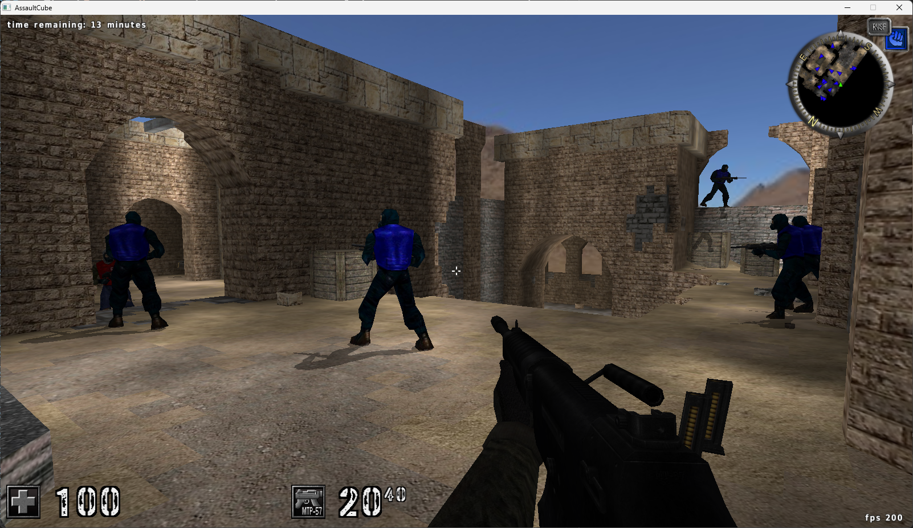
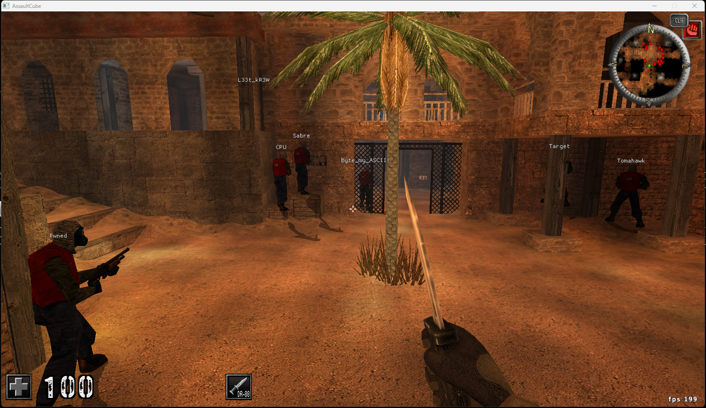

# Overlay

A Windows overlay project developed in C++ using **WinAPI, DirectX 11, and Dear ImGui**.

This project explores Windows desktop application development, real-time graphics rendering, and object-oriented design. It was developed to gain practical experience working with lower-level Windows and graphics APIs while building an application with a modular architecture.

The project combines Windows window management, DirectX 11 rendering, and an immediate-mode graphical user interface to produce a real-time overlay.

> **Project scope:** The application entry point and DirectX rendering implementation have intentionally been left out to prevent straightforward replication.

---

## Table of Contents

- [Project Overview](#project-overview)
- [Technologies](#technologies)
- [Architecture Overview](#architecture-overview)
  - [Component Responsibilities](#component-responsibilities)
  - [Component Relationships](#component-relationships)
- [Application Lifecycle](#application-lifecycle)
  - [Window Registration and Creation](#1-window-registration-and-creation)
  - [Windows Message Handling](#2-windows-message-handling)
  - [DirectX 11 Initialization](#3-directx-11-initialization)
  - [Dear ImGui Initialization](#4-dear-imgui-initialization)
  - [Main Application Loop](#5-main-application-loop)
- [Source Code](#source-code)
  - [Bot](#bot)
  - [BotManager](#botmanager)
  - [Overlay](#overlay)
  - [ProcessManager](#processmanager)
- [Demonstration](#demonstration)
  - [Overlay](#overlay-1)
  - [What the Screenshot Shows](#what-the-screenshot-shows)
- [Design Decisions](#design-decisions)
  - [Separation of Responsibilities](#separation-of-responsibilities)
  - [Renderer Encapsulation](#renderer-encapsulation)
- [Dependencies](#dependencies)
  - [Windows API](#windows-api)
  - [DirectX 11](#directx-11)
  - [Dear ImGui](#dear-imgui)
- [Disclaimer](#disclaimer)

---

## Project Overview

The objective of this project was to develop a C++ overlay while gaining a deeper understanding of how Windows applications and graphics rendering systems work.

Rather than relying entirely on an existing overlay framework, the project uses WinAPI and DirectX 11 to establish the underlying application and rendering infrastructure.

The application is divided into several components, each responsible for a specific part of the system.

The primary areas of focus were:

- **Windows Programming:** Creating and managing Windows applications and handling window messages through WinAPI.
- **Graphics Programming:** Initializing DirectX 11 resources and managing the rendering pipeline.
- **User Interface Development:** Integrating Dear ImGui for graphical interface generation.
- **Object-Oriented Design:** Separating application responsibilities into individual classes.
- **Resource Management:** Managing DirectX resources and application shutdown.
- **Build Configuration:** Organizing the project using CMake.

## Technologies

| Technology | Purpose |
|---|---|
| C++ | Primary programming language |
| WinAPI | Windows window creation and message handling |
| DirectX 11 | Graphics rendering |
| Dear ImGui | Immediate-mode graphical user interface |
| CMake | Build system and project configuration |

## Architecture Overview

The project follows a modular structure that separates application logic, data management, and rendering responsibilities.

```text
Overlay/
│
├── external/
│   └── imgui/                  # Dear ImGui dependency
│
├── include/
│   ├── bot.h                   # Bot representation
│   ├── botmanager.h            # Bot management
│   ├── offsets.h               # Game data
│   ├── overlay.h               # Overlay interface
│   ├── processmanager.h        # Game process management
│   └── vectors.h               # Utilities
│
├── src/
│   ├── bot.cpp                 # Bot implementation
│   ├── botmanager.cpp          # Bot management implementation
│   └── overlay.cpp             # Overlay implementation
│
└── CMakeLists.txt              # Build configuration
```

### Component Responsibilities

| Component | Responsibility |
|---|---|
| `Bot` | Represents an individual bot and its associated data |
| `BotManager` | Manages the collection of bot objects |
| `Overlay` | Coordinates application-level overlay updates and graphical elements |
| `ProcessManager` | Encapsulates process-management responsibilities |
| `Renderer` | DirectX 11 rendering component; implementation omitted |
| `main.cpp` | Application entry point and initialization sequence; implementation omitted |

### Component Relationships

At a high level, the application follows this structure:

```text
              Application
                   |
                   v
                Overlay
                   |
           +-------+-------+
           |               |
           v               v
       BotManager       Renderer
           |               |
           v               v
          Bot          DirectX 11
                           |
                           v
                         ImGui
```

## Application Lifecycle

The application uses WinAPI to establish the Windows environment before initializing the graphics and user interface components.

Although the original entry-point implementation is not included, its responsibilities can be summarized in several stages.

### 1. Window Registration and Creation

The application begins by registering a Windows window class.

This provides Windows with the information needed to create and manage the application window.

The initialization process includes:

- Registering a window class.
- Defining a window procedure.
- Locating the target application window.
- Retrieving its window dimensions.
- Creating the overlay window.
- Configuring its window styles and transparency behavior.

The overlay uses a separate Windows window rather than modifying the target application's rendering pipeline.

### 2. Windows Message Handling

Windows applications rely on a message-driven architecture.

The window procedure receives messages generated by Windows, including events related to:

- Window creation and destruction.
- Mouse input.
- Keyboard input.
- Window state changes.

### 3. DirectX 11 Initialization

After creating the overlay window, the application initializes its graphics infrastructure.

The renderer is responsible for creating and managing several DirectX resources.

| Resource | Responsibility |
|---|---|
| `ID3D11Device` | Creates graphics resources |
| `ID3D11DeviceContext` | Issues rendering commands |
| `IDXGISwapChain` | Manages frame buffers and presentation |
| `ID3D11RenderTargetView` | Provides a rendering destination |

The device, device context, and swap chain are initialized through `D3D11CreateDeviceAndSwapChain()`.

A render target view is then created from the swap chain's back buffer.

This provides DirectX with a destination to which graphical content can be rendered.

### 4. Dear ImGui Initialization

Dear ImGui requires its own context before graphical elements can be generated.

The original application initializes:

- The ImGui context.
- The Win32 platform backend.
- The DirectX 11 rendering backend.

These components serve different purposes:

| Component | Responsibility |
|---|---|
| ImGui Context | Maintains GUI state and generates drawing instructions |
| Win32 Backend | Connects ImGui to the Windows application |
| DX11 Backend | Renders ImGui drawing instructions through DirectX 11 |

Once initialized, the application can begin generating and rendering GUI elements.

### 5. Main Application Loop

The application follows a continuous frame-based rendering loop.

Each iteration updates application state, generates graphical elements, renders the interface, and presents the completed frame.

The overall lifecycle can be summarized as:

```text
       Register Window Class
                |
                v
           Create Window
                |
                v
       Initialize DirectX 11
                |
                v
         Initialize ImGui
                |
                v
         Application Loop
                |
        +-------+-------+
        |               |
        v               v
    Update State    Generate GUI
        |               |
        +-------+-------+
                |
                v
          Render Frame
                |
                v
          Present Frame
                |
                v
              Repeat
                |
                v
          Application Exit
                |
                v
          Release Resources
```

## Source Code

Rather than documenting every implementation line individually, this section describes the responsibilities and design of the main components.

### Bot

The `Bot` class represents an individual entity within the application's data model.

It provides a dedicated structure for organizing entity-related information.

Separating entity representation into its own class avoids placing all data and behavior directly into the overlay implementation.

### BotManager

The `BotManager` class is responsible for managing collections of `Bot` objects.

It separates entity management from the higher-level overlay logic.

This makes the application easier to organize and allows the overlay to interact with a managed collection rather than handling individual entity objects directly.

### Overlay

The `Overlay` class coordinates the higher-level application logic.

It acts as the connection between application state, entity management, and graphical presentation.

This helps keep the application's responsibilities separated rather than combining all functionality into the entry point.

### ProcessManager

The `ProcessManager` component encapsulates process-management functionality.

Keeping this responsibility separate from the other classes helps avoid coupling process-related operations directly to the overlay's graphical logic.

## Demonstration

Before demonstrating the overlay, the following screenshot showcases the game state before any modifications. 



### Overlay



### What the Screenshot Shows

- A separately managed overlay window.
- Integration with the target application's window.
- Graphical elements rendered through DirectX 11. 
- Dear ImGui integration.
- Continuous frame updates and presentation. (Player Names)

## Design Decisions

### Separation of Responsibilities

Application logic, entity management, and rendering responsibilities were separated into individual components. 

This reduces unnecessary dependencies between classes and makes the overall architecture easier to understand.

### Renderer Encapsulation

The renderer encapsulates DirectX resources and rendering operations.

This prevents graphics-specific functionality from spreading throughout the application.

## Dependencies

### [Windows API](https://learn.microsoft.com/en-us/windows/win32/api/)

The Windows API is used to interact directly with the Windows operating system and manage the window's lifecycle.

### [DirectX 11](https://learn.microsoft.com/en-us/windows/win32/direct3d11/atoc-dx-graphics-direct3d-11)

DirectX 11 is used to provide the graphics infrastructure for rendering and displaying the overlay.

### [Dear ImGui](https://github.com/ocornut/imgui)

Dear ImGui is responsible for generating the overlay and producing the drawing instructions required for its elements.

## Disclaimer

This project was developed for educational purposes, with a focus on C++, Windows development, and graphics programming.